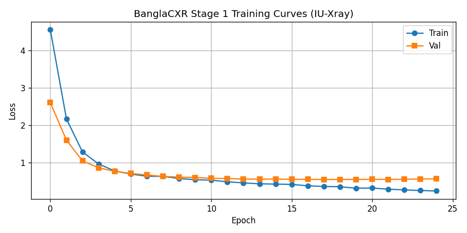
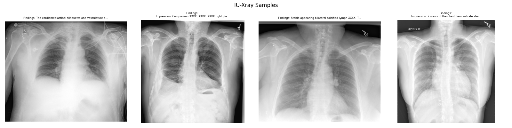

<div align="center">



<br>


<h3>Chest X-ray &nbsp;→&nbsp; structured English report &nbsp;→&nbsp; Bangla report</h3>

<p>
A two-stage vision-language pipeline built for reproducible medical AI research on a single consumer GPU:<br>
a frozen radiology encoder, a learned anatomy-guided bridge, a 4-bit adapted LLM, and multilingual translation.
</p>

<a href="#-why-banglacxr"><b>Why</b></a> ·
<a href="#-pipeline"><b>Pipeline</b></a> ·
<a href="#-results"><b>Results</b></a> ·
<a href="#-projector-ablation"><b>Ablation</b></a> ·
<a href="#-figure-gallery"><b>Figures</b></a> ·
<a href="#-quickstart"><b>Quickstart</b></a>

</div>


## 💡 Why BanglaCXR?

Most chest X-ray report-generation systems produce English text only. That limits practical use in Bangla-speaking hospitals and telemedicine workflows, where language accessibility is part of clinical usability. BanglaCXR explores a lightweight, reproducible route from radiological image to Bangla report without requiring a large end-to-end multimodal model.

<table>
<tr>
<td width="25%" valign="top">

### 🩻 Radiology-native vision
**RAD-DINO**, a chest X-ray encoder, stays frozen — no costly vision fine-tuning.

</td>
<td width="25%" valign="top">

### 🧩 Learned visual bridge
**32 learned cross-attention queries** compress 1,370 patch tokens into 32 embeddings for the LLM.

</td>
<td width="25%" valign="top">

### ⚡ Fits a laptop GPU
**Phi-3.5 Mini** in 4-bit with QLoRA, trained on a single RTX 5050 Laptop GPU (8.5 GB).

</td>
<td width="25%" valign="top">

### 🌏 Bangla output
**NLLB-200**, with a 19-term medical glossary applied before translation.

</td>
</tr>
</table>

## 🧭 Pipeline

<p align="center">
  
</p>

<table>
<tr>
<td width="60%" valign="top">

#### Stage 1 · English report generation

- **Vision encoder** — RAD-DINO, kept frozen during training.
- **Visual-language bridge** — `AnatomyGuidedProjector`: 32 learnable queries (randomly initialised) attend to the 1,370 patch tokens through 8-head cross-attention, then a 2-layer MLP maps them from 768 to 3,072 dimensions.
- **Language model** — Phi-3.5 Mini, 4-bit NF4 quantization, LoRA rank 32 / alpha 64 on attention and MLP projections (50.3M trainable LoRA parameters, 1.30% of the LLM).
- **Training** — 3× oversampling of reports flagged abnormal by a keyword rule, bf16 autocast, gradient accumulation (effective batch 16), validation-loss checkpointing and early stopping (patience 8).
- **Decoding** — greedy, up to 200 new tokens, with a custom repetition penalty.

</td>
<td width="40%" valign="top">

#### Stage 2 · Bangla translation

- **Translator** — NLLB-200 distilled 600M.
- **Terminology** — 19 English clinical terms are replaced with Bangla equivalents before translation.
- **Output** — structured Bangla reports with the generated findings and impression.

</td>
</tr>
</table>

<details>
<summary><b>Mermaid version of the pipeline</b></summary>
<br>


</details>


## 📊 Results

Evaluation uses **550 held-out IU X-ray studies** (one frontal image per study; split 2,566 / 550 / 550, seed 42).

<p align="center">
  
</p>

<table>
<tr>
<td width="50%" valign="top">

#### Stage 1 · English report generation

| Metric | Score |
| :--- | ---: |
| BLEU-1 | 0.2884 |
| BLEU-2 | 0.1664 |
| BLEU-4 | 0.0699 |
| ROUGE-1 | 0.4352 |
| ROUGE-2 | 0.1604 |
| ROUGE-L | 0.3103 |
| METEOR | 0.2820 |
| chrF (sentence-averaged) | 41.32 |

</td>
<td width="50%" valign="top">

#### Stage 2 · Bangla translation

| Metric | Score |
| :--- | ---: |
| Bangla BLEU-1 | 0.2626 |
| Bangla BLEU-2 | 0.1358 |
| Bangla BLEU-4 | 0.0502 |
| Bangla chrF (sentence-averaged) | 35.18 |

> [!NOTE]
> Bangla scores are computed against Bangla references produced by the same NLLB translation procedure. Read them as pipeline-consistency indicators, not as a substitute for evaluation against human-authored Bangla radiology reports.

</td>
</tr>
</table>

<details>
<summary><b>How the metrics were computed</b></summary>
<br>

- **BLEU:** NLTK `corpus_bleu` on whitespace-split text (no lowercasing or punctuation tokenization) with smoothing method 1. Scores are therefore not directly comparable to papers that use the `pycocoevalcap` toolkit.
- **ROUGE:** `rouge-score` F-measure with stemming, averaged over studies.
- **METEOR:** NLTK `meteor_score`, averaged over studies.
- **chrF:** `sacrebleu.corpus_chrf` with default settings (`word_order=0`), computed per study and averaged. This is chrF, not chrF++. With `word_order=2` (true chrF++), the same outputs score 39.24 (English) and 31.35 (Bangla).

</details>

<details>
<summary><b>Rule-based label metrics (diagnostic only; not suitable as claims)</b></summary>
<br>

The notebook also reports keyword-based abnormality and clinical-entity scores. These numbers come straight from the notebook, but the rules behind them do not handle negation reliably, so the scores should not be cited as evidence of clinical accuracy.

| Metric | Score | Caveat |
| :--- | ---: | :--- |
| Abnormality precision / recall / F1 | 0.7993 / 0.9795 / 0.8802 | TP 430, FN 9, FP 108, TN 3 (specificity 2.7%). Labelling every report as abnormal gives F1 0.888. |
| Clinical entity micro-F1 / macro-F1 | 0.5897 / 0.3321 | Patterns such as `pleural effusion` and `pneumothorax` also match negated mentions ("no pleural effusion"). |

</details>

## 🔬 Projector ablation

> [!WARNING]
> **The FlatMLP ablation is not yet a valid comparison, and its numbers are not reported here.** The baseline notebook (`bangla_cxr_local_stage_1_baseline.ipynb`) differs from Stage 1 in ways that confound the result:
>
> 1. **Decoding:** the baseline was evaluated with a loop that feeds only the newest token, with no cache and no history. After the first token the model has lost all context. The 550 saved baseline outputs contain only 2 distinct strings. Its prompt also differs from the training prompt (`\<` instead of `\n`).
> 2. **Training targets:** the baseline masks prompt and padding tokens out of the loss and has no EOS token. Stage 1 trains on the full sequence, including padding, so the two validation losses (1.571 vs. 0.552) are not comparable.
> 3. **Augmentation:** the image augmentations differ (flip probability, rotation).
>
> The FlatMLP checkpoint can be re-evaluated with the Stage 1 decoding function without retraining. A fully controlled ablation would also retrain the baseline with the Stage 1 dataset class.


## 🎨 Figure gallery

<table>
<tr>
<td width="50%" align="center"><br><sub><b>Stage 1 training curves</b>: best validation loss 0.5516 at epoch 18, early stop after epoch 25 (the plot's x-axis is 0-indexed)</sub></td>
<td width="50%" align="center"><br><sub><b>Methodology</b> overview (its "chrF++" labels refer to chrF; see the metric notes above)</sub></td>
</tr>
<tr>
<td width="50%" align="center"><br><sub><b>IU X-ray training samples</b> with truncated reports</sub></td>
<td width="50%" align="center"><br><sub><b>Stage 1 architecture</b></sub></td>
</tr>
</table>

## 🚀 Quickstart

### 1 · Environment

The reported runs used a single **NVIDIA GeForce RTX 5050 Laptop GPU (8.5 GB as reported by PyTorch)** on Windows with Python 3.10 and PyTorch 2.11 (CUDA 12.8), with `num_workers=0`. They rely on 4-bit bitsandbytes quantization, bfloat16 autocast where supported, and gradient checkpointing.

```bash
# Install the CUDA build of PyTorch that matches your GPU (see pytorch.org), then:
pip install transformers==5.9.0 peft==0.19.1 accelerate==1.13.0 bitsandbytes==0.49.2 \
            trl datasets timm einops scikit-learn nltk rouge-score sacrebleu \
            sentencepiece Pillow pandas matplotlib seaborn
```

### 2 · Dataset

The IU X-ray dataset is **not included**. Obtain it from its original distribution and follow its terms and citation requirements. The notebooks expect one folder containing:

```text
indiana_reports.csv        # report text
indiana_projections.csv    # image projections and filenames
images_normalized/         # normalized chest X-ray images
```

Set `IU_XRAY_BASE` (Stage 1) or `DATA_DIR` (baseline) in the paths cell to that folder.

After cleaning and keeping one frontal image per study, 3,666 image–report pairs remain. They are split 70 / 15 / 15 with `random_state=42` into 2,566 / 550 / 550 studies.

### 3 · Run the notebooks

| Step | Notebook | What it does |
| :---: | :--- | :--- |
| 1 | `bangla_cxr_local_stage_1.ipynb` | Set paths, prepare data, load RAD-DINO and Phi-3.5, apply LoRA, train, and save the best checkpoint |
| 2 | `bangla_cxr_local_stage_1.ipynb` | Evaluate the checkpoint on the test set and export the generated English reports as JSON |
| 3 | `bangla_cxr_local_stage_2.ipynb` | Point `JSON_PATH` at that export, translate with NLLB-200 and the glossary, and evaluate |
| — | `bangla_cxr_local_stage_1_baseline.ipynb` | FlatMLP projector ablation (needs re-evaluation, see [above](#-projector-ablation)) |

Checkpoints and generated outputs are written locally and are not part of this repository.

## 📁 Repository layout

```text
.
├── asset_for_readme/                        # Animated SVGs used in this README
├── diagrams/                                # Thesis figures and diagrams
├── bangla_cxr_local_stage_1.ipynb           # Main English report-generation experiment
├── bangla_cxr_local_stage_1_baseline.ipynb  # FlatMLP ablation
├── bangla_cxr_local_stage_2.ipynb           # Bangla translation and evaluation
├── Thesis Report.docx                       # Thesis report
├── Thesis Report updated 1.docx             # Thesis report (revised)
└── README.md
```

## 📚 Citation

A citation entry will be added once the manuscript has a final publication or repository identifier. Until then, please cite it as an unpublished research manuscript.

## 📜 License and data

This repository contains research code, notebooks, the thesis report and figures. Dataset and pretrained-model licenses remain separate and must be respected when reproducing the experiments or redistributing outputs.


<div align="center">
<sub>RAD-DINO · AnatomyGuidedProjector · Phi-3.5 Mini · NLLB-200 — চিকিৎসা সেবায় বাংলা ভাষা</sub>
</div>
